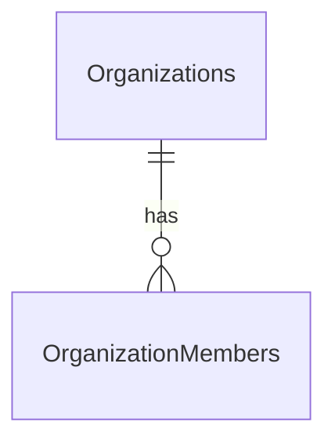

# Write a Shipwise spec

You are the planner (BA, solution architect, tech lead). The spec is the only input the
implementing agents get, so anything left vague becomes a guess. Do not write product code.

The work has two steps with a hard gate between them: **1. challenge the input** and stop
for the user's answers, then **2. write the spec**. Never skip step 1; scale it to the size
of the request (a one-field change gets a three-line brief, a new module gets the full one).

## Step 1: Challenge the input

You are the user's sparring partner, not their typist. Find what is wrong, missing or
weaker than it could be before the cost of being wrong is paid in code. Be direct and
specific, do not flatter, and when the idea is sound say so in one line. Never invent
objections to look rigorous: every finding needs evidence.

1. **Load context.** Read `AGENTS.md`, `ARCHITECTURE.md`, existing specs in `docs/specs`,
   ADRs in `docs/adr`, and in `../Shipwise-Web`: `AGENTS.md`, `DESIGN.md` and
   `docs/architecture/*`.
2. **Restate.** One short paragraph: who has the problem, what they do today, what they can
   do after this ships, and how success is measured. If you cannot write it, that gap is
   your first question.
3. **Check reasonableness.** Label each finding `blocker`, `risk` or `note`, and state its
   basis: `verified` (a file and line, an ADR or a linked source), `assumed` (plausible but
   unconfirmed; say what depends on it), `open` (needs the user's decision) or `conflict`
   (contradicts an approved spec, an ADR or the code). Check:
   - Problem: real and specific, or a solution looking for a problem? Who needs it?
   - Value vs cost: the smallest version that proves the value; what can be cut or deferred.
   - Fit: conflicts with `AGENTS.md`, `ARCHITECTURE.md`, ADRs, existing specs, module
     boundaries (one database per module, no cross-module foreign keys), the contract-first
     order, or the ef-migrations rules.
   - Risk: security, authorization and tenancy, personal data and privacy, destructive data
     changes, performance at the expected volume, operability and observability.
   - Gaps: permissions, concurrency, deletion and restore, empty and failure states, limits
     and abuse, time zones, idempotency of writes, duplicate submissions, partial failure
     and stale state.
   - Impact: which existing flows, data and contract consumers change or could break.
   - Proof: what observable evidence would show each outcome works; an outcome nobody can
     test is not a requirement yet.
   - Unrecorded decisions (identity, persistence, messaging, a new dependency): propose an
     ADR in `docs/adr/NNNN-slug.md` before the spec.
4. **Research real-world practice.** Use WebSearch, and WebFetch for primary sources, to see
   how 2-4 established products or standards solve the same problem (for example how
   GitHub, Stripe, Linear or Shopify model organizations, invitations, roles or audit logs;
   RFCs, OWASP, WCAG for standards). Prefer official documentation, standards and vendor
   engineering posts over listicles. For each source: what they do, why, and what it
   implies for Shipwise. Link every source and summarize in your own words (no long
   quotes). If search is unavailable, say so and mark claims from memory as unverified.
   Never send the user's private details or unpublished business data in a search query.
5. **Propose alternatives.** Steelman the user's approach first, then give at least one
   materially different alternative, including "use what exists" or "don't build it yet"
   when that is credible. Compare them and recommend one, saying what would change your
   recommendation.
6. **Ask questions.** Only questions whose answer changes scope, design or acceptance
   criteria, and that the code, docs or research cannot answer. At most five per round,
   most important first; each says why it matters and the default you will assume if it
   stays unanswered. Use AskUserQuestion when it is available, recommended option first.

Post the brief in chat in this shape, then stop. Do not create the spec file until the user
has resolved every blocker and chosen an approach.

```markdown
## Challenge brief: <feature>
**Understanding:** <restatement>
**Verdict:** go | go with changes | rethink, and why in one sentence

### Findings
| # | Severity | Basis | Finding | Evidence |

### Real-world practice
- <Product or standard>: <what they do>; implication for us ([source](url))

### Approaches
| Approach | How it works | Pros | Cons | Cost and risk |
**Recommendation:** <approach>, because ...; I would change my mind if ...

### Questions
1. <question>? Why it matters: ... Default if unanswered: ...
```

**Defending a position.** When the user pushes back, re-examine your finding against their
argument. Change your mind when they bring new information; when they do not, restate your
concern once with its evidence. The user decides. Record the decision and any unresolved
concern in the spec's "Research and alternatives" section, then proceed without
relitigating it.

## Step 2: Write the spec

Start only after the brief is answered. Carry the chosen approach, the research and the
answers into the spec; anything still unanswered becomes a recorded assumption using the
default you stated. The process around the spec (lanes, gates, who decides) is in
`docs/workflow.md`; a change that fits its small change lane needs no spec.

### Design proposal before approval

When the feature adds or changes screens, check the depth table in `docs/workflow.md`. If
it asks for a proposal, do not finalize "UI and states" yourself:

1. Write the draft spec with stories, acceptance criteria and a first API contract.
2. Give the user this handoff for Gemini, run in `../Shipwise-Web`: "Read spec NNNN in
   ../Shipwise/docs/specs and docs/design/proposals/README.md. Write the design proposal
   for it in docs/design/proposals/NNNN-slug/. Do not change production code."
3. When the proposal exists, reconcile it into the spec: every screen and state is in
   "UI and states"; every field a screen shows or sends exists in the API contract; every
   action maps to an endpoint and an acceptance criterion; nothing needs a token that
   `DESIGN.md` lacks. Raise each mismatch with the user instead of choosing silently.
4. Record the proposal path and commit in the spec header, then ask for approval.

## File

`docs/specs/NNNN-slug.md`, numbered after the highest existing spec, with
`Status: draft | approved | done`. Only a human sets `approved`; implementers start only
from approved specs. Branches for the spec are named `feat/NNNN-slug` in both repositories.

## Template

````markdown
# NNNN Title

Status: draft · Owner: Claude Code · Related ADRs: none · Design proposal: none

## Problem and outcome
Who has the problem, what they can do after this ships, and how we will know.

## Scope
In scope / Out of scope (explicit list).

## Research and alternatives
Real-world practice from the challenge brief (product or standard, what it does, link).
Approaches considered with their trade-offs, the one chosen and why, and any concern the
planner raised that the user decided against (kept so reviewers know it was weighed).

## User stories and acceptance criteria
- US-1: As a <role>, I can <action> so that <value>.
  - AC-1: Given ... when ... then ... (each criterion testable; include permissions/tenancy)
  - AC-2: ...
Number criteria AC-1, AC-2, ... across the whole spec and never renumber after approval.

## Non-functional requirements
Only the ones that apply: response-time or volume targets, limits and rate limits,
availability, audit, privacy and retention. Write "None beyond platform defaults" if so.

## API contract
Endpoints (method, path, request, response, status codes, error shape), auth and tenancy
rules, idempotency for writes, pagination. This becomes the OpenAPI document at
contracts/openapi/shipwise.v1.json; the frontend never invents fields beyond it.

## Backend design
Module and layer placement (Domain, Application, Infrastructure, API), aggregates and
invariants, commands vs queries, events or outbox use, observability.

Sequence diagram (Mermaid `sequenceDiagram`): required when the flow crosses modules, uses
messaging or the outbox, or has a step sensitive to concurrency or retries. Show the
authorization step and the main failure paths. Omit it for a plain request and response.

Rollout and compatibility: what existing clients or data see while this deploys, the order
backend and frontend must ship in, and how to roll back.

## Database design
Follows the ef-migrations skill. Write "No database changes" if none, and skip the rest.
Module database / schema: shipwise_<module> / <module>

### Entity relationships


### Tables
One table per database table (new or changed; mark changed rows with "changed").
All rows in this section's tables and diagram are format examples; replace them.
`"Organizations"` · base: SoftDeletableEntity · aggregate root · organization-owned: no · Version (xmin): yes

| Column | Type | Null | Default | Key / index | Sensitive | Notes |
|---|---|---|---|---|---|---|
| Id | uuid | no | app (v7) | PK_Organizations | no | |
| Slug | varchar(64) | no | | UX_Organizations_Slug (filtered: not deleted) | no | lowercase, CK_Organizations_Slug |
| DisplayName | varchar(200) | no | | | no | |
| CreatedAt … DeletedBy | audit columns | | | | no | from SoftDeletableEntity |

Relationships: FK, principal, delete behavior (Restrict unless the child is owned).
Check constraints: name and rule for each.

### Query patterns
Every read and uniqueness check the feature performs, and the index that serves it.

| Query (who, filter, sort, page size) | Frequency | Index |
|---|---|---|
| A member lists their organizations, by DisplayName, 50/page | every page load | IX_OrganizationMembers_UserId |

### Data lifecycle
Delete model (soft or hard) per table, retention, sensitive columns and how they are kept
out of logs and telemetry, seed or reference data (fixed GUIDs), expected row volume.

### Migration plan
| Order | Migration name | Destructive | Steps (expand/contract, backfill, concurrent index) |
|---|---|---|---|
| 1 | Initial | no | create schema, tables, indexes, constraints |

Destructive: yes needs a separate expand and contract migration per release and human
approval before the spec is approved.

## UI and states
Routes, screens and components; for each screen the states that apply: loading, empty,
success, validation error, request failure with retry, submitting or disabled, and
permission-denied; responsive behavior at 375/768/1440px; accessibility notes. Reference
DESIGN.md tokens; no new tokens without a human-approved DESIGN.md change. Built from the
design proposal when docs/workflow.md asks for one.

## Test plan
| Criterion | Test (type and where) |
|---|---|
| AC-1 | Backend unit test in tests/... |
| AC-2 | Playwright E2E in Shipwise-Web tests/e2e/... |

Every criterion has at least one test. When the feature reads or writes organization-owned
data, these are mandatory: a user without the permission is refused, and a user of another
organization can neither read nor change the data (backend tests, not only UI checks).

## Tasks
| # | Owner | Repo | Paths | Covers | Depends on | Done when (commands) |
|---|-------|------|-------|--------|------------|----------------------|
| 1 | Codex | Shipwise | src/Modules/<Name>/**, contracts/openapi/** | AC-1, AC-3 | - | scripts/Verify-Platform.ps1 passes |
| 2 | Codex | Shipwise-Web | src/lib/api/**, src/features/<name>/api/** | AC-1 | 1 | npm run check passes |
| 3 | Gemini | Shipwise-Web | src/features/<name>/components/**, pages/** | AC-1, AC-2 | 2 | npm run check, npm run test:e2e, impeccable detect clean |
| 4 | Claude Code | both | review (review-pr skill) | all | 1-3 | no open blocker, definition of done met |

## Assumptions and open questions

## Change log
Changes made after approval: date, what changed, why, who approved. Empty until then.

## Delivery record
Filled when the spec is closed: pull request links per task, approved deviations, the
date the human confirmed the integration check, deferred follow-ups.
````

## Rules for the database design

- Every column the code will map appears in the Tables section with its exact type, length
  and nullability; names and types follow the ef-migrations skill sections 2 and 3.
- Every index comes from a row in Query patterns or from a foreign key; no speculative
  indexes, and no query without an index that serves it.
- Mark a column sensitive when it holds personal data, credentials or secrets; sensitive
  columns never reach logs or telemetry.
- The implementing agent builds exactly what the database design says. Any deviation is a
  spec change first, approved by a human.

## Rules for the task table

- Follow the ownership rules in both `AGENTS.md` files: Codex owns the backend and the
  frontend data layer; Gemini owns frontend presentation; Claude reviews.
- No two tasks that can run at the same time share a path. Shared hot files
  (`Directory.Packages.props`, `Shipwise.slnx`, `package.json`/`package-lock.json`,
  `src/app/router/**`, `DESIGN.md`, `src/styles/globals.css`) belong to exactly one task.
- Each task is one pull request with verification commands that prove it done.
- Each task lists the acceptance criteria it covers, and every criterion is covered by at
  least one task and one row of the test plan.
- Keep slices thin: one user-visible outcome per spec. Split anything bigger.

## Finish

Summarize the spec in a few lines, list the decisions taken from the challenge brief and the
open questions, and ask the user to approve it.

## After approval

- **Changing the spec.** An implementer's decision request, a review finding or the user
  can show the approved spec is wrong. Follow "Changing an approved spec" in
  `docs/workflow.md`: state what was approved and the new evidence, propose the smallest
  fix with alternatives, get the user's approval, edit the spec, add a change log line and
  say which tasks must be redone. Never renumber acceptance criteria; retire or add them.
- **Closing.** When every task's pull request is merged and the user confirms their
  integration check, set `Status: done` and fill the delivery record. Suggest updates to
  `AGENTS.md` or a skill when the feature exposed a missing rule.
