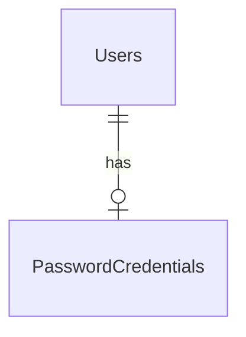

# 0001 User registration

Status: draft · Owner: Claude Code · Related ADRs: 0001, 0002, 0003 · Design proposal: pending (`Shipwise-Web/docs/design/proposals/0001-user-registration/`)

## Problem and outcome

Nobody can have a Shipwise account yet, so nothing that depends on knowing who a user is
can be built. After this ships, a person can create one account with their email, a
display name and a password. We know it works when a new account can be created from the
frontend, the same email cannot be registered twice, and the stored password cannot be
read back.

This is the first of several steps toward "one person, many organizations, one role in
each" (ADR 0002). It delivers the account only.

## Scope

In scope
- A public endpoint that creates an account.
- The `Users` and `PasswordCredentials` tables and the module's first migration.
- A registration page with a confirmation state.
- Publishing the first API contract file (ADR 0003).
- A local development route so the frontend can reach the Identity API through the Gateway.

Out of scope (each is a later spec)
- Sign-in, sign-out, sessions, tokens, "who am I" (spec 0002).
- Email verification, password reset, changing email or password.
- Organizations, memberships, roles, invitations.
- Account deletion, profile editing, avatars, locale and time zone.
- External sign-in providers.
- A Docker image or compose service for the Identity API.

## Research and alternatives

- Auth0 Organizations and GitHub both keep one account per person and attach roles to the
  organization membership, not to the account
  ([Auth0](https://auth0.com/docs/manage-users/organizations/organization-roles),
  [GitHub](https://docs.github.com/en/enterprise-server@3.17/organizations/managing-peoples-access-to-your-organization-with-roles/roles-in-an-organization)).
  So the account created here carries no organization and no role.
- OWASP guidance, read through secondary summaries only: slow salted password hashing,
  and identical responses whether or not an account exists
  ([Password Storage](https://cheatsheetseries.owasp.org/cheatsheets/Password_Storage_Cheat_Sheet.html),
  [Authentication](https://cheatsheetseries.owasp.org/cheatsheets/Authentication_Cheat_Sheet)).
- The owner's DeliveryPilot Identity module registers with display name, email and
  password, answers 409 for an existing email and returns the new user id. This spec keeps
  that shape and changes validation to field-keyed errors.

Approaches considered, with the owner's decisions:

| Question | Chosen | Alternative not chosen |
|---|---|---|
| Who owns accounts | Shipwise, email and password (ADR 0001) | External provider only |
| Size of this spec | Registration only | Registration plus sign-in |
| Email verification | Later, as its own spec | Required before the account is usable |
| Existing email | 409 plus rate limiting | Uniform "check your email" response, which needs email sending |

Concern recorded, accepted by the owner for now: answering 409 for an existing email lets
an outsider test whether an address has an account. ADR 0001 requires revisiting this in
the email verification spec.

## User stories and acceptance criteria

- US-1: As a visitor, I can create an account with my email, display name and password so
  that I can later sign in to Shipwise.
  - AC-1: Given a valid request with an email that has no account, when it is submitted,
    then the API answers 201 with the new user id, one `Users` row exists with the trimmed
    email, its lowercase form and the trimmed display name, and one `PasswordCredentials`
    row exists for that user.
  - AC-2: Given an account exists for `ana@example.com`, when someone registers
    ` Ana@Example.com ` (different case, surrounding spaces), then the API answers 409 with
    code `Registration.EmailTaken` and no row is added or changed.
  - AC-3: Given a request where the email is malformed, the display name is blank or
    longer than 100 characters, or the password is shorter than 12 or longer than 128
    characters, when it is submitted, then the API answers 400 with code
    `Validation.Failure` and `errors` keyed by `email`, `displayName` and `password`,
    reporting every invalid field in one response, and no row is added.
  - AC-4: Given a successful registration, then the stored value is a hash that verifies
    against the submitted password and is not the password; the password and the hash
    appear in no response, log line, trace, metric or exception message.
  - AC-5: Given two requests for the same new email arrive at the same time, then exactly
    one answers 201 and the other answers 409 `Registration.EmailTaken`; neither answers
    500, and one account exists.
  - AC-6: Given one client has sent 5 registration requests within a minute, when it sends
    another, then the API answers 429 with code `Request.TooManyRequests` and a
    `Retry-After` header, and no account is created.
  - AC-7: The endpoint needs no token, and a successful registration issues no token,
    cookie or session; the response contains only the user id.
  - AC-12: Given the setting `Registration:Enabled` is false or missing, when anyone sends
    a registration request, then the API answers 404 with code `Request.NotFound` and
    creates nothing. The setting is true in `appsettings.Development.json` and absent from
    `appsettings.json`, so registration is closed everywhere else until the owner opens it.
- US-2: As a visitor, I can use a registration page that tells me clearly what is wrong or
  that my account was created.
  - AC-8: Given the generated contract, the frontend data layer exposes a registration
    mutation that sends the three fields, and maps the API's 400 field errors, 409 and 429
    into typed results without showing raw server text.
  - AC-9: Given the registration page, when I submit invalid input, then each field shows
    its own message (client-side rules match AC-3, and server field errors are shown on the
    same fields); when the email is taken, the email field says so; when rate limited, the
    form says to wait and try again.
  - AC-10: Given a submission is in flight, the submit control is disabled and shows
    progress, and a second submission cannot be sent; when it succeeds, the page shows a
    confirmation naming the email and does not sign me in.
  - AC-11: The page works at 375, 768 and 1440px, every field has a visible label, errors
    are announced to assistive technology, focus moves to the first invalid field, and the
    whole form is usable by keyboard.

## Non-functional requirements

- Registration is limited to 5 requests per minute per client address, counted at the
  Identity API using the address forwarded by the trusted Gateway.
- The request body is limited to 16 KB.
- Hashing one password should take well under one second on the development machine; no
  other performance target yet.
- Email, display name and password hash are personal or secret data: never logged or put
  in telemetry.

## API contract

`POST /api/v1/auth/register` · public (no token) · not idempotent (a repeat answers 409)

Request body (JSON):

| Field | Type | Rules |
|---|---|---|
| `email` | string | Required. Trimmed. 3 to 254 characters. Must look like an email address. |
| `displayName` | string | Required. Trimmed. 1 to 100 characters. No control characters. Need not be unique. |
| `password` | string | Required. 12 to 128 characters. Used exactly as sent, never trimmed. |

Responses (all in the `{ success, data, error }` envelope; cqrs-api skill sections 4 and 5):

| Status | When | Body |
|---|---|---|
| 201 | Account created | `data: { "userId": "<uuid>" }` |
| 400 | Any field invalid, or malformed JSON | `error.code: "Validation.Failure"`, `error.errors: { "<field>": ["<message>"] }` |
| 404 | Registration is switched off (AC-12) | `error.code: "Request.NotFound"` |
| 409 | An account exists for the normalized email | `error.code: "Registration.EmailTaken"` |
| 413 | Body larger than 16 KB | Platform default |
| 429 | Rate limit exceeded | `error.code: "Request.TooManyRequests"`, header `Retry-After: <seconds>` |

Field names in `errors` are the JSON names above. No permission is required and no
organization is involved. The committed contract file is produced as ADR 0003 describes.

## Backend design

Module: Identity. Layout per the cqrs-api and module-skeleton skills.

- **Domain** (`Shipwise.Identity.Domain/Models`): `User` (`Entity`), created through a
  factory that trims and validates the email and display name with `Guard`, computes the
  normalized email, and passes a v7 id to the base constructor. `PasswordCredential`
  (`Entity`) holds the user id and the hash. `Authorization/` is not created yet.
- **Application** (`Features/Auth/Commands/RegisterUser/`): `RegisterUserCommand`
  (`ICommand<RegisterUserResponse>`, with `ToString` overridden so the password can never
  be printed), `RegisterUserCommandValidator` (collects every field problem and throws one
  `ValidationException`), `RegisterUserCommandHandler`, `RegisterUserResponse(Guid UserId)`.
  Ports in `Abstractions/Repositories` (`IUserRepository`, `IPasswordCredentialRepository`)
  and `Abstractions/Security` (`IPasswordHashService`).
- **Handler flow**: normalize the email; if a user exists for it, throw
  `ConflictException("Registration.EmailTaken", ...)`; create the user; hash the password;
  add both entities; return the id. It does not save: the pipeline's unit of work does.
- **Infrastructure**: entity configurations, the two repositories, `PasswordHashService`
  over ASP.NET Core `PasswordHasher<User>` (ADR 0001), registered in `AddInfrastructure`.
- **Concurrent duplicates (AC-5)**: the unique index is the final guard. A unique
  violation on `UX_Users_NormalizedEmail` surfaces when the unit of work saves, and must
  become the same 409. Add a small map in `Persistence/Core` from constraint name to
  exception, consulted by `IdentityUnitOfWork` for PostgreSQL unique violations; unknown
  constraints are rethrown unchanged. The unit of work itself keeps no business names.
- **API**: `Controllers/AuthController : PublicApiController` (injects `ISender`),
  `Contracts/Auth/RegisterUserRequest`. The action applies the rate limit policy and the
  16 KB limit and returns `StatusCode(201, response)`.
- **Rate limiting**: ASP.NET Core's built-in rate limiter (no new package), a fixed window
  of 5 per minute partitioned by client address, rejecting with 429, the envelope and
  `Retry-After`.
- **Contract (ADR 0003)**: documentation envelope types in `Shipwise.AspNetCore`, and the
  Swagger setup fixed per ADR 0003 decision 5 (title, readable schema names, nullability
  and required fields, lowercase paths); then the drift test and the first
  `contracts/openapi/shipwise.v1.json`.
- **Registration switch (AC-12)**: an options class bound to `Registration:Enabled`
  (default false). When false, the action answers 404 before sending the command.
- **Gateway**: a Development-only routes file `proxy.Development.json` that forwards
  `POST /api/v1/auth/register` to the Identity API on `http://127.0.0.1:19091`, selected by
  `Gateway:RoutesFile` in `appsettings.Development.json`, and copied to the output like
  `proxy.json` (the project file copies only `proxy.json` today). Production routing stays
  deployment configuration. Checked on 2026-11-17 with both hosts running: a POST through
  the Gateway reached the Identity API, and a GET was refused by the Gateway with 405.
- **Observability**: the existing pipeline logs the request type name only. Add no log
  that includes the email. Count registrations by outcome (created, email taken, invalid,
  rate limited) only if it can be done with the existing metrics helpers.

No sequence diagram: this is a single request and response inside one module.

Rollout and compatibility: nothing is deployed yet and no client exists, so there is no
compatibility concern. The migration runs through the MigrationRunner before the API
starts. Rolling back means dropping the two tables, acceptable only because no real data
exists yet.

## Database design

Follows the ef-migrations skill. Module database / schema: `shipwise_identity` / `identity`.

### Entity relationships

### Tables

`"Users"` · base: Entity · aggregate root · organization-owned: no · Version (xmin): yes

| Column | Type | Null | Default | Key / index | Sensitive | Notes |
|---|---|---|---|---|---|---|
| Id | uuid | no | app (v7) | PK_Users | no | |
| Email | varchar(254) | no | | | yes | As entered, trimmed |
| NormalizedEmail | varchar(254) | no | | UX_Users_NormalizedEmail | yes | Trimmed, lowercase invariant |
| DisplayName | varchar(100) | no | | | yes | Trimmed |
| CreatedAt … UpdatedBy | audit columns | | | | no | From Entity; `CreatedBy` is null because nobody is signed in |

`"PasswordCredentials"` · base: Entity · aggregate root · organization-owned: no · Version (xmin): no

| Column | Type | Null | Default | Key / index | Sensitive | Notes |
|---|---|---|---|---|---|---|
| Id | uuid | no | app (v7) | PK_PasswordCredentials | no | |
| UserId | uuid | no | | UX_PasswordCredentials_UserId | no | One credential per user |
| PasswordHash | varchar(512) | no | | | yes | Output of `PasswordHasher<User>`; never the password |
| CreatedAt … UpdatedBy | audit columns | | | | no | From Entity |

Relationships: `FK_PasswordCredentials_Users_UserId` to `Users.Id`, delete behavior
`Cascade`. Allowed because `Users` is a hard-deleted `Entity` and a credential has no
meaning without its user.
Check constraints: none.

### Query patterns

| Query (who, filter, sort, page size) | Frequency | Index |
|---|---|---|
| Registration checks whether a user exists for a normalized email | Every registration | UX_Users_NormalizedEmail |
| Uniqueness of the normalized email at insert | Every registration | UX_Users_NormalizedEmail |
| Sign-in loads a user's credential by user id (spec 0002) | Every sign-in | UX_PasswordCredentials_UserId |

### Data lifecycle

Both tables use hard delete, and this spec adds no way to delete. Rows are kept until an
account deletion spec defines otherwise. Sensitive columns: `Email`, `NormalizedEmail`,
`DisplayName` (personal data) and `PasswordHash` (secret); none may appear in logs,
traces, metrics or error messages. No seed data. Expected volume: thousands of rows.

### Migration plan

| Order | Migration name | Destructive | Steps (expand/contract, backfill, concurrent index) |
|---|---|---|---|
| 1 | Initial | no | Create schema `identity`, both tables, the two unique indexes and the foreign key |

## UI and states

Built from the design proposal, which is required because this is a new page
(`docs/workflow.md`). Until it exists, this section lists only what the proposal must
cover; it is not final.

- Route `/register`, public, reachable without signing in. The proposal decides whether it
  sits inside or outside the application shell.
- Fields: email, display name, password, with the rules from the API contract. The
  proposal decides whether to show a password visibility toggle and length guidance.
- States: idle, client validation error, submitting, server field errors, email taken,
  rate limited, request failure with retry, success (confirmation naming the email).
- After success there is nowhere to go until spec 0002 adds sign-in; the proposal says
  what the confirmation offers.
- Responsive at 375, 768 and 1440px; accessibility per AC-11; DESIGN.md tokens only.

## Test plan

| Criterion | Test (type and where) |
|---|---|
| AC-1 | HTTP test with PostgreSQL in `tests/Shipwise.Identity.Tests`: 201, then both rows read back |
| AC-2 | HTTP test with PostgreSQL: second registration with different case and spaces answers 409; row counts unchanged |
| AC-3 | Validator unit tests for each rule and for several invalid fields at once; HTTP test (no database) for the 400 body shape |
| AC-4 | HTTP test with PostgreSQL: stored hash differs from the password and verifies; unit test that the command's `ToString` hides the password |
| AC-5 | HTTP test with PostgreSQL: parallel requests for one email give one 201 and the rest 409, one row |
| AC-6 | HTTP test (no database): the sixth request in a window answers 429 with the code and `Retry-After` |
| AC-7 | HTTP test: no `Authorization` header needed; response has no `Set-Cookie`; body has only `userId` |
| AC-12 | HTTP test (no database): with `Registration:Enabled` false or missing, a valid request answers 404 and the handler is never called |
| AC-3, AC-1 (model) | Unit tests for `User` creation: trimming, normalization, limits; migration tests required by the ef-migrations skill, including the unique indexes |
| ADR 0003 | Contract drift test: the served document equals `contracts/openapi/shipwise.v1.json` |
| AC-8 | Frontend unit tests for the mutation and error mapping in `src/features/auth/api` |
| AC-9, AC-10 | Frontend component tests for each state |
| AC-9, AC-10, AC-11 | Playwright in `Shipwise-Web/tests/e2e`, with the HTTP boundary mocked from the generated contract: success, taken email, validation, keyboard path, three widths |

No organization-owned data is involved, so the cross-organization tests do not apply.

## Tasks

| # | Owner | Repo | Paths | Covers | Depends on | Done when (commands) |
|---|-------|------|-------|--------|------------|----------------------|
| 1 | Codex | Shipwise | `src/Modules/Shipwise.Identity/**`, `tests/Shipwise.Identity.Tests/**`, `contracts/openapi/**`, `src/BuildingBlocks/Shipwise.AspNetCore/**` (envelope documentation types and Swagger setup only), `src/Gateway/Shipwise.Gateway/**` (Development routes file and its copy rule only), `README.md` | AC-1 to AC-7, AC-12 | - | `scripts/Verify-Platform.ps1 -RequireInfrastructure` passes with no skipped test; `dotnet ef migrations has-pending-model-changes` prints no changes; the idempotent SQL script is in the handoff report |
| 2 | Codex | Shipwise-Web | `src/lib/api/**`, `src/features/auth/api/**`, `src/features/auth/schemas/**`, `src/features/auth/index.ts`, a stub `src/features/auth/pages/register-page.tsx`, `src/app/router/**`, `vite.config.ts` (development proxy only), `.env.example`, `docs/architecture/api-integration.md` | AC-8 | 1 | `npm run check` passes; generated types committed and unedited |
| 3 | Gemini | Shipwise-Web | `src/features/auth/components/**`, `src/features/auth/pages/**`, `tests/e2e/**` for this page | AC-9, AC-10, AC-11 | 2 | `npm run check` and `npm run test:e2e` pass; impeccable detect clean or triaged |
| 4 | Claude Code | both | review (review-change skill) | all | 1-3 | no open blocker, definition of done met |

Task 2 creates the page file as a stub so the route can be registered; from task 3 on that
file belongs to Gemini.

## Assumptions and open questions

Decided by the owner on 2026-11-17: password hashing with the built-in PBKDF2 hasher;
limits as written (password 12 to 128, display name up to 100, email up to 254, 5
registrations per minute per client); display names need no rule beyond length and may
repeat; registration can be switched off and is off outside Development (AC-12); after
registering, the page confirms and does not sign the person in; local requests go through
the Gateway.

Assumptions still to prove in the tasks:
- In local development the browser reaches the API as: Vite dev proxy `/api` → Gateway
  (19090) → Identity API (19091). The Gateway half was checked (see Backend design); the
  Vite proxy is not checked yet.
- The rate limit partitions by the client address the Gateway forwards. The Identity API
  trusts forwarded headers only from loopback by default (`AddTrustedForwarding`), which
  fits local development; deployment must list the Gateway's address.
- The constraint-to-exception map is a new piece of the unit of work; if it proves
  awkward, Codex stops and proposes an alternative.

No open questions.

## Change log

Empty until the spec is approved.

## Delivery record

Empty until the spec is closed.
