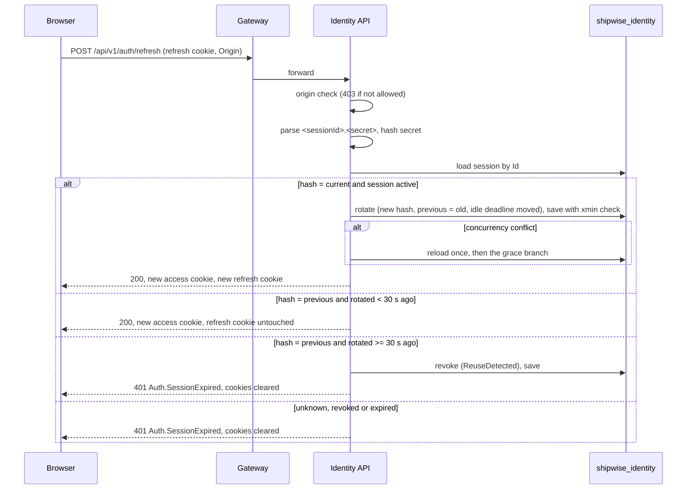
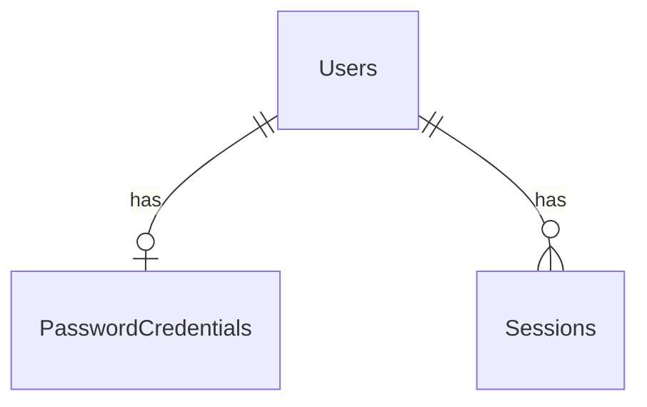

# 0003 Sign-in and sessions

Status: approved · Owner: Claude Code · Related ADRs: 0005, 0001, 0002 · Design proposal: `Shipwise-Web/docs/design/proposals/0003-sign-in-and-sessions/proposal.md` (Shipwise-Web commit c21dc60)

## Problem and outcome

People can create an account (spec 0001) but cannot use it: nothing issues tokens, and
every protected endpoint answers 401 because no session validator exists. After this
ships, a person signs in with email and password, stays signed in across page reloads
for up to 30 days, sees who they are signed in as, and can sign out.

We know it works when these hold:
- A registered user signs in from the frontend and reaches the workspace.
- A protected endpoint answers for them, and still does after a page reload.
- After sign-out, the same request answers 401.
- Repeated wrong passwords for one email are throttled.

## Scope

In scope
- Sign-in, refresh, sign-out and "who am I" endpoints in the Identity module.
- A `Sessions` table, the session validator, and refresh-token rotation (ADR 0005).
- Cookie transport of both tokens and the cross-site origin check (shared libraries).
- Sign-in throttling, per client address and per email.
- An `[AuthenticatedUserOnly]` marker and the cqrs-api skill rule for it.
- A sign-in page, protected workspace routes, the user menu with sign-out, and a "Sign
  in" link on the registration confirmation.

Out of scope (later specs)
- Organizations, the `orgs` membership claim and the freshness rule (ADR 0005 decisions
  8 and 9; spec 0004).
- Listing sessions, signing out everywhere, password change and reset, email
  verification, multi-factor sign-in, "remember me".
- Account lockout. Throttling is temporary by design.
- Session checks by other module hosts, and asymmetric signing (ADR 0005 decisions 10
  and 11).
- A scheduled cleanup of old sessions (arrives with the first Worker).

## Research and alternatives

The challenge brief (2026-11-24) and ADR 0005 hold the research:
- [RFC 10017](https://www.rfc-editor.org/rfc/rfc10017.html): keep tokens out of
  browser JavaScript.
- [RFC 9700](https://www.rfc-editor.org/rfc/rfc9700.html): rotate refresh tokens.
- [NIST SP 800-63B-4](https://pages.nist.gov/800-63-4/sp800-63b/session):
  re-authenticate at most every 30 days for password-only sign-in.
- [OWASP Session Management](https://cheatsheetseries.owasp.org/cheatsheets/Session_Management_Cheat_Sheet.html):
  cookie attributes, idle and absolute timeouts.
- [GitHub sessions](https://docs.github.com/en/enterprise-cloud@latest/authentication/keeping-your-account-and-data-secure/viewing-and-managing-your-sessions):
  server-side sessions that can be revoked one by one.

Decisions taken by the owner on 2026-11-24 (all the planner's recommended defaults):

| Question | Chosen | Not chosen |
|---|---|---|
| How the browser holds the session | Both tokens in HttpOnly, SameSite=Strict cookies (ADR 0005 option C) | Access token in page memory with a refresh cookie; a stateful Gateway session |
| Session length | 10-minute access token; session ends 7 days after the last refresh or 30 days after sign-in; no "remember me" | Shorter sessions (24 hours) |
| Repeated failures | Per-address rate limit and a temporary per-email limit; no lockout | Permanent lockout after N failures |
| Session management in this spec | Sign in, refresh, sign out of this session, "who am I" | Session list and "sign out everywhere" |
| Unverified accounts | May sign in | Sign-in blocked until verification exists |

Concerns recorded, accepted for now:
- A script injected into the page can act as the user while the page is open, though it
  cannot read a token.
- The per-email throttle lives in memory and resets when the API restarts.

## User stories and acceptance criteria

- US-1: As a registered user, I can sign in with my email and password so that I can use
  Shipwise.
  - AC-1: Given an account and its correct password, when I send them to
    `POST /api/v1/auth/sign-in`, then:
    - The API answers 200 with `userId`, `email` and `displayName`. The email is matched
      after trimming and lowercasing.
    - Exactly one `Sessions` row is created for the user.
    - The response sets the access cookie and the refresh cookie with the attributes in
      the API contract.
    - The access token carries `sub` (the user id), `sid` (the new session id), `iss`,
      `aud`, `iat`, and an `exp` 10 minutes after issue.
    - No token appears in the response body.
  - AC-2: Given an unknown email, or a known email with a wrong password, then the API
    answers 401 `Auth.InvalidCredentials` with the same message in both cases, no
    session is created, and no cookie is set. For an unknown email the password is still
    checked against a fixed dummy hash, so the two cases take comparable time.
  - AC-3: Given a request where `email` or `password` is missing or empty, the email is
    longer than 254 characters, or the password is longer than 128 characters, then the
    API answers 400 `Validation.Failure` with `errors` keyed by `email` and `password`.
    No session is created.
  - AC-4: Given one client address has sent 10 sign-in requests within a minute, when it
    sends another, then the API answers 429 `Request.TooManyRequests` with `Retry-After`,
    and no session is created.
  - AC-5: Given 10 failed sign-ins for one normalized email within 15 minutes, when
    anyone signs in with that email before those 15 minutes have passed since the first
    failure, then the API answers 429 `Request.TooManyRequests` with `Retry-After` even
    when the password is correct. Other emails are unaffected. A successful sign-in
    before the limit is reached clears that email's count.
  - AC-6: Given a stored hash that `PasswordHasher` reports as needing an upgrade, when
    the user signs in successfully, then the stored hash is replaced by a fresh hash of
    the same password.
  - AC-7: The password, both tokens and the refresh secret never appear in a response
    body. None of them, nor the email or display name, appears in a log line, trace,
    metric or exception message. The database stores only the SHA-256 hash of the
    refresh secret.
  - AC-8: Given a request that carries a valid refresh cookie for an active session, when
    sign-in succeeds, then that earlier session is revoked with reason `Replaced` before
    the new one is created.
- US-2: As a signed-in user, I stay signed in while I use Shipwise, and only while my
  session is valid.
  - AC-9: Given an active session, when I call `GET /api/v1/account` with the access
    cookie, or with the same token as a bearer header, then the API answers 200 with my
    `userId`, `email` and `displayName`.
  - AC-10: Given an access token that has not expired, when its session is revoked, idle
    for more than 7 days, or older than 30 days, then any protected request with it
    answers 401 `Request.Unauthorized`.
  - AC-11: Given a valid refresh cookie, when I call `POST /api/v1/auth/refresh`, then:
    - The API answers 200 with `userId`, `email` and `displayName`.
    - It sets a new access cookie and a new refresh cookie. The old refresh token becomes
      the session's previous token.
    - The session's idle deadline moves to 7 days from now, but never past its absolute
      deadline of 30 days after sign-in.
  - AC-12: Given a refresh token that was rotated less than 30 seconds ago, when the
    previous token is presented to refresh, then the API answers 200 and sets a new
    access cookie but no refresh cookie, and the session stays active.
  - AC-13: Given a refresh token that was rotated 30 seconds or more ago, when the
    previous token is presented, then:
    - The session is revoked with reason `ReuseDetected`.
    - The API answers 401 `Auth.SessionExpired` and clears both cookies.
    - Protected requests with that session's access token answer 401 from then on.
  - AC-14: Given a missing, malformed or unknown refresh token, or one whose session is
    revoked or past either deadline, when refresh is called, then the API answers 401
    `Auth.SessionExpired` and clears both cookies.
  - AC-15: Given two refresh requests with the same current token at the same moment,
    then both answer 200, the session stays active, and neither answers 409 or 500.
- US-3: As a signed-in user, I can sign out.
  - AC-16: Given an active session, when I call `POST /api/v1/auth/sign-out`, then:
    - The API answers 200, revokes the session with reason `SignedOut`, and clears both
      cookies.
    - The old access token then gets 401, and the old refresh token gets 401
      `Auth.SessionExpired`.
    - Sign-out without cookies, or with an unknown or already revoked session, also
      answers 200 and clears both cookies.
- US-4: As a user, I am protected from other sites using my session.
  - AC-17: Given an unsafe request (`POST`, `PUT`, `PATCH`, `DELETE`) whose `Origin`
    header is missing or not in the host's `Cors:AllowedOrigins`, when it goes to
    sign-in, refresh or sign-out, or carries an auth cookie, then the API answers 403
    `Request.OriginRejected` and changes nothing. A request authenticated only by a
    bearer header, with no auth cookie, is not checked.
- US-5: As a user, I can sign in and out from the frontend and the workspace knows who I
  am.
  - AC-18: Given the generated contract, the frontend data layer provides:
    - a sign-in mutation, a sign-out mutation and an account query;
    - a fetch client that sends same-origin credentials. When a protected request answers
      401, it refreshes once, sharing one in-flight refresh among concurrent requests in
      the tab, then retries the request once. If the refresh answers 401, the session
      state becomes signed out. If it fails any other way (network, 5xx, 403), the session
      state becomes "check failed", which can be retried, and the user is not signed out;
    - typed results for sign-in's 400, 401 and 429, without showing raw server text.
  - AC-19: Given the sign-in page at `/sign-in`, when I submit, then:
    - Invalid input shows a message on each field.
    - Wrong credentials show one form-level message that does not say which field was
      wrong.
    - Throttling shows a wait message with the seconds from `Retry-After`.
    - While submitting, the button is disabled and a second submission cannot be sent.
    - On success I land on the `returnTo` path if it is a path inside the app, otherwise
      on `/organizations`.
  - AC-20: Given I am signed out, when I open any workspace route, then:
    - I am sent to `/sign-in?returnTo=<that path>`.
    - While the app checks my session it shows a loading indicator, and no workspace
      content appears before the check ends.
    - If the check fails for a reason other than 401, a full-page error with "Try again"
      is shown and repeats the check. I am not sent to `/sign-in`.
    - Given I am signed in, when I open `/sign-in` or `/register`, I am sent to
      `/organizations`.
  - AC-21: Given I am signed in, then the user menu shows my display name and initials
    instead of the placeholder. "Sign out" calls sign-out, clears all cached server data,
    and takes me to `/sign-in`, even when the sign-out request fails.
  - AC-22: The registration confirmation (spec 0001) shows a "Sign in" link to `/sign-in`.
    No email or other personal data is put in the URL.
  - AC-23: The sign-in page and the user menu work at 375, 768 and 1440px and by keyboard
    alone. Every field has a visible label, errors are announced to assistive technology,
    and focus moves to the first invalid field or the form-level message.

## Non-functional requirements

- Lifetimes:
  - access token: 10 minutes;
  - session: ends 7 days after its last refresh, and 30 days after sign-in at the latest;
  - refresh grace window: 30 seconds.

  Each is a setting with these defaults (`Jwt:AccessTokenExpirationMinutes`,
  `Session:IdleTimeoutDays`, `Session:AbsoluteTimeoutDays`, `Session:RefreshGraceSeconds`).
- Each protected request adds one primary-key read of `Sessions` and no write.
- Sign-in, refresh and sign-out bodies are limited to 16 KB.
- Rate limits: 10 sign-in requests per minute per client address, counted at the Identity
  API from the address forwarded by the trusted Gateway. Per normalized email: 10 failures
  in a 15-minute window, held in memory, which assumes one Identity API instance
  (ADR 0004).
- Personal and secret data never reaches logs or telemetry: email, display name, password,
  tokens, refresh hashes. Count sign-ins by outcome (succeeded, invalid credentials,
  throttled) only if the existing metrics helpers allow it without the email.

## API contract

Every response uses the `{ success, data, error }` envelope (cqrs-api skill sections 4 and 5).

Cookies set by the API:

| Cookie | Name outside Development / in Development | Attributes | Lifetime |
|---|---|---|---|
| Access | `__Host-shipwise-access` / `shipwise-access` | `HttpOnly`, `SameSite=Strict`, `Path=/`, `Secure` outside Development | `Max-Age` = token lifetime (600 s) |
| Refresh | `__Secure-shipwise-refresh` / `shipwise-refresh` | `HttpOnly`, `SameSite=Strict`, `Path=/api/v1/auth`, `Secure` outside Development | `Expires` = the session's idle deadline |

"Clears both cookies" means `Set-Cookie` with the same name and path and `Max-Age=0`.
Every protected host accepts the access token from the access cookie, or from
`Authorization: Bearer <token>` when that header is present.

`POST /api/v1/auth/sign-in` · public · origin-checked · not idempotent (each success
creates a session)

| Field | Type | Rules |
|---|---|---|
| `email` | string | Required, trimmed, 1 to 254 characters. No format check: an unknown address simply fails. |
| `password` | string | Required, 1 to 128 characters, used exactly as sent |

| Status | When | Body |
|---|---|---|
| 200 | Signed in; both cookies set | `data: { "userId": "<uuid>", "email": "<string>", "displayName": "<string>" }` |
| 400 | Missing or too-long field, or malformed JSON | `Validation.Failure`, `errors` keyed by `email`, `password` |
| 401 | Unknown email or wrong password | `Auth.InvalidCredentials` |
| 403 | Origin missing or not allowed | `Request.OriginRejected` |
| 413 | Body larger than 16 KB | Platform default |
| 429 | Per-address or per-email limit | `Request.TooManyRequests`, header `Retry-After: <seconds>` |

`POST /api/v1/auth/refresh` · public (uses the refresh cookie) · origin-checked · no body

| Status | When | Body |
|---|---|---|
| 200 | Session active: rotated, or previous token within the grace window | `data: { "userId", "email", "displayName" }`; new access cookie; new refresh cookie unless in the grace window |
| 401 | Missing, malformed, unknown, revoked, expired or reused token | `Auth.SessionExpired`; both cookies cleared |
| 403 | Origin missing or not allowed | `Request.OriginRejected` |

`POST /api/v1/auth/sign-out` · public (uses the refresh cookie) · origin-checked · idempotent · no body

| Status | When | Body |
|---|---|---|
| 200 | Always, whether or not a session was found; both cookies cleared | empty `data` |
| 403 | Origin missing or not allowed | `Request.OriginRejected` |

`GET /api/v1/account` · signed-in user, own account only (`[AuthenticatedUserOnly]`, no
permission)

| Status | When | Body |
|---|---|---|
| 200 | Active session | `data: { "userId", "email", "displayName" }` |
| 401 | No token, invalid or expired token, or inactive session | `Request.Unauthorized` |

Error codes added: `Auth.InvalidCredentials` (401), `Auth.SessionExpired` (401) and
`Request.OriginRejected` (403). No organization is involved, so no organization
permission applies. The committed contract is regenerated as ADR 0003 describes; it does
not describe cookies, so the cookie table above is the agreement for them.

## Backend design

Module: Identity, laid out per the cqrs-api skill, plus shared-library changes.

**Domain** (`Shipwise.Identity.Domain/Models`)
- `Session` (`Entity`, aggregate root) with these members:
  - `Start(userId, refreshSecretHash, now, idleTimeout, absoluteTimeout)`;
  - `Rotate(newHash, now, idleTimeout)`;
  - `AcceptsPrevious(hash, now, grace)`;
  - `Revoke(reason, now)`;
  - `IsActive(now)`.

  `Rotate` never moves the idle deadline past the absolute one.
- `SessionRevocationReason` enum: `SignedOut = 1`, `ReuseDetected = 2`, `Replaced = 3`.

**Application** (`Features/Auth/...`)
- Commands:
  - `SignInCommand` → `SignInResult` (account fields, access token and expiry, refresh
    token and idle deadline);
  - `RefreshSessionCommand` → `RefreshResult` (same, with the refresh token null in the
    grace case);
  - `SignOutCommand`.
- Query: `GetAccountQuery(userId)` → `AccountResponse`.
- Each command overrides `ToString` so that no password or token can be printed.
- Ports:
  - `ISessionRepository`;
  - `IAccessTokenIssuer`;
  - `IRefreshTokenCodec` (creates, parses and hashes `<sessionId>.<secret>`, compares
    hashes in constant time);
  - `ISignInThrottle`;
  - the existing `IPasswordHashService`, gaining a verify method that reports "rehash
    needed".
- Sign-in flow:
  1. Check the per-email throttle.
  2. Load the user by normalized email.
  3. Verify the password, against the dummy hash when there is no user.
  4. Record a failure, or clear the count.
  5. Rehash if needed.
  6. Revoke a session presented by the refresh cookie as `Replaced`.
  7. Delete this user's expired or revoked sessions.
  8. Start the session and issue the tokens.
- Expected failures are thrown: `UnauthorizedException` with `Auth.InvalidCredentials` or
  `Auth.SessionExpired`, and a too-many-requests exception mapped to 429. The
  too-many-requests exception and its mapping live in Identity and write the same
  `Request.TooManyRequests` envelope and `Retry-After` header as the registration rate
  limiter. Handlers never save; the pipeline's unit of work does.
- Refresh, sign-out, and sign-in's "revoke as `Replaced`" step load the session with a
  row lock (`SELECT ... FOR UPDATE`, parameterized) inside the command's transaction. A
  second refresh of the same token waits for the first to commit, then reads the rotated
  row and takes the grace path (AC-15). The `xmin` token stays as a safety net. The
  validator's read stays no-tracking and unlocked.
- Reuse detection must persist the revocation even though the request answers 401. The
  unit of work rolls back a failed `Result`, so `RefreshSessionCommand` returns a
  successful `Result` whose value says the session ended, and the controller maps that
  outcome to 401 and clears both cookies. This is the one documented exception to "throw,
  do not return failures", and it must be covered by a test.

**Infrastructure**
- `SessionConfiguration` and the repository.
- `AccessTokenIssuer` over `JsonWebTokenHandler`, with the existing `Jwt` options.
- `SessionContextValidator : IAuthenticatedContextValidator`: a no-tracking read by `Id`
  and `UserId`, then `IsActive(now)`. Registered in the Identity API.
- `MemorySignInThrottle` over `IMemoryCache`, keyed by the SHA-256 of the normalized
  email.

**API** (`Shipwise.Identity.API`)
- `AuthController : PublicApiController` gains `sign-in`, `refresh` and `sign-out`. Each
  carries the origin-check marker and the 16 KB limit; sign-in also carries the
  `sign-in` rate-limit policy (10 per minute per client address).
- The controller writes and clears cookies through one `AuthCookieWriter` built from
  `AuthCookieOptions`.
- `AccountController : ApiController` with `GET` marked `[AuthenticatedUserOnly]`, at
  route `api/v1/account`.

**Shared libraries** (`Shipwise.AspNetCore`)
- `AuthCookieOptions`: cookie names, `Secure`, and the refresh path. Development and
  production defaults as in the contract.
- `CustomJwtBearerEvents.MessageReceived` takes the token from the access cookie when no
  `Authorization` header is present.
- `OriginCheckMiddleware` and its endpoint marker (AC-17), using `Cors:AllowedOrigins`,
  registered after routing and before authentication. It answers in the platform
  envelope.
- `[AuthenticatedUserOnly]` in `Shipwise.AspNetCore.Security`: a marker for actions that
  act only on the caller's own account. The cqrs-api skill section 5 says when to use it
  (the spec must say so) and its checklist accepts it in place of `[PermissionAuthorize]`.

**Gateway** (`proxy.Development.json`): routes for `POST` sign-in, refresh and sign-out,
and `GET /api/v1/account`, to the Identity API. YARP forwards `Cookie` and `Set-Cookie`
unchanged.

**Configuration**
- `Jwt:AccessTokenExpirationMinutes` becomes 10 in every template that sets it.
- The new `Session:*` settings get the defaults above.
- `Cors:AllowedOrigins` of the Identity API must contain the frontend's origin in each
  environment. The compose files already pass `SHIPWISE_FRONTEND_ORIGIN`; confirm it
  reaches the Identity API.

**Observability**: the pipeline logs request type names only. Do not add logs with email,
display name or token values. A reuse detection logs a warning with the session id only.

Rollout and compatibility:
- Nothing is deployed. The migration adds a table only.
- The backend task lands first. The frontend tasks start after the contract is pushed.
- Rolling back is a revert plus dropping the `Sessions` table, which holds only sessions.

## Database design

Follows the ef-migrations skill. Module database / schema: `shipwise_identity` / `identity`.

### Entity relationships

### Tables

`"Sessions"` · base: Entity · aggregate root · organization-owned: no · Version (xmin): yes

| Column | Type | Null | Default | Key / index | Sensitive | Notes |
|---|---|---|---|---|---|---|
| Id | uuid | no | app (v7) | PK_Sessions | no | The `sid` claim and the first part of the refresh token |
| UserId | uuid | no | | IX_Sessions_UserId | no | |
| RefreshTokenHash | varchar(64) | no | | | yes | SHA-256 of the current secret, lowercase hex |
| PreviousRefreshTokenHash | varchar(64) | yes | | | yes | Hash before the last rotation |
| RotatedAt | timestamp with time zone | yes | | | no | Time of the last rotation |
| IdleExpiresAt | timestamp with time zone | no | | | no | Last refresh + 7 days, capped at `ExpiresAt` |
| ExpiresAt | timestamp with time zone | no | | | no | Sign-in + 30 days |
| RevokedAt | timestamp with time zone | yes | | | no | |
| RevocationReason | smallint | yes | | | no | `CK_Sessions_RevocationReason`: null or 1, 2, 3 |
| CreatedAt … UpdatedBy | audit columns | | | | no | From Entity |

Relationships: `FK_Sessions_Users_UserId` to `Users.Id`, delete behavior `Cascade`
(`Users` is a hard-deleted `Entity`; a session has no meaning without its user).

Check constraints:
- `CK_Sessions_RevocationReason`: `"RevocationReason" IS NULL OR "RevocationReason" IN (1, 2, 3)`;
- `CK_Sessions_Revocation`: `("RevokedAt" IS NULL) = ("RevocationReason" IS NULL)`.

`"PasswordCredentials"` (changed behavior only, no schema change): `PasswordHash` can now
be updated on sign-in (AC-6).

### Query patterns

| Query (who, filter, sort, page size) | Frequency | Index |
|---|---|---|
| The validator reads a session by id and user id | Every protected request | PK_Sessions |
| Refresh and sign-out load a session by id | Every refresh (about every 10 minutes per active user), every sign-out | PK_Sessions |
| Sign-in deletes the user's expired or revoked sessions | Every sign-in | IX_Sessions_UserId |
| Sign-in finds a user by normalized email | Every sign-in | UX_Users_NormalizedEmail (exists) |
| Sign-in loads the credential by user id | Every sign-in | UX_PasswordCredentials_UserId (exists) |

### Data lifecycle

- **Delete model:** `Sessions` rows are hard deleted. A user's expired or revoked
  sessions are deleted at their next sign-in. Revoked rows otherwise stay until then,
  which keeps reuse detection possible.
- **Retention:** at most 30 days of useful life per row.
- **Sensitive columns:** both hash columns are secret and never logged.
- **Seed data:** none.
- **Volume:** a few active sessions per user.

### Migration plan

| Order | Migration name | Destructive | Steps |
|---|---|---|---|
| 1 | AddSessions | no | Create `Sessions` with its index, foreign key and check constraints |

## UI and states

Built from the design proposal (`proposal.md`, path in the header), which holds the
layout, component and token detail. Where the two differ, this section wins. The
proposal raised no contract gap and adds no design token.

**Routes**
- `/sign-in`: public, in `PublicLayout`, beside `/register`. The `PublicLayout` wordmark
  now links to `/sign-in` instead of `/register`.
- Workspace routes under `AppLayout` are protected (AC-20).
- `/sign-in` and `/register` redirect a signed-in user to `/organizations`.
- `returnTo` is accepted only if it starts with a single `/` and is not `//` or a URL.

**Sign-in card.** Same pattern and sizes as the registration card (44px inputs, toggle
and button). It is titled "Sign in" and has:
- an Email field (`type="email"`, `autoComplete="username"`);
- a Password field (`type="password"`, `autoComplete="current-password"`, Show/Hide
  toggle with `aria-pressed`);
- a form-level alert area above the button;
- a submit button "Sign in";
- a "Create an account" link to `/register` below the form.

Neither field has helper text.

**Sign-in states**

| State | Shows | Focus |
|---|---|---|
| Loading the route | `LoadingIndicator` | - |
| Idle | The form | - |
| Client validation error | Message under each invalid field; `aria-invalid` | First invalid field |
| Submitting | Button disabled, reading "Signing in…"; inputs read-only; a status region announces it; no second submission | Unchanged |
| Server field errors (400) | The frontend's own message on each field named in `error.errors`, never server text | First invalid field |
| Invalid credentials (401) | Alert "Email or password is incorrect."; email kept, password cleared | The alert |
| Throttled (429) | Alert "Too many sign-in attempts. Please wait N seconds and try again.", where N comes from `Retry-After` (without it: "a moment"); email kept | The alert |
| Failure (network, 5xx, 403, 413) | Alert "Unable to sign in right now. Please try again."; submit re-enabled; email kept | The alert |
| Success (200) | Password cleared from memory; navigate to `returnTo` or `/organizations`. The account from the 200 body seeds the account query. | - |

**Session check** (workspace routes, and `/sign-in` and `/register`)

| State | Shows |
|---|---|
| Checking | A full-page centered `LoadingIndicator`; no sidebar, header or page content |
| Signed in | The workspace; or, on `/sign-in` and `/register`, a redirect to `/organizations` |
| Signed out (401 after the one refresh) | A redirect to `/sign-in?returnTo=<path>`; on `/sign-in` and `/register`, the page itself |
| Check failed (network, 5xx, 403) | A full-page `ErrorState` with "Try again", which repeats the check |

**User menu** (`AppLayout`)
- The trigger shows an initials badge and, from `sm` up, the display name truncated to
  `max-w-40`.
  - Initials are derived in the browser: the first letters of the first two words of the
    display name, or the first two characters of a single word, in uppercase.
- The menu label shows the display name over the email, each truncated to one line.
- Items: "My Profile" (unchanged), a separator, then "Sign out". "Sign out" replaces
  "Logout (not connected)" and the "Authentication is not configured." note.
- While signing out, the item is disabled and reads "Signing out…", and a status region
  announces it.
- After the request succeeds or fails, all cached server data is cleared and the user
  goes to `/sign-in`.

**Registration confirmation**: the existing card adds a "Sign in" link button (44px) to
`/sign-in`, with no query string. The heading keeps focus, and the link is the next Tab
stop.

**Accessibility**
- Keyboard order on sign-in: skip link, wordmark, email, password, Show/Hide, submit,
  "Create an account".
- Form-level alerts use `role="alert"` and can receive focus (`tabIndex={-1}`).
- The user menu relies on the dropdown's own keyboard handling and returns focus to its
  trigger.
- Every field has a visible label linked to its error. Nothing relies on colour alone.
- Works at 375, 768 and 1440px.

Permission-denied does not apply: every screen here is about the user's own session.

## Test plan

| Criterion | Test (type and where) |
|---|---|
| AC-1 | HTTP test with PostgreSQL in `tests/Shipwise.Identity.Tests`: 200 body, both `Set-Cookie` headers and their attributes (Development and production options), token claims and lifetime, one session row |
| AC-2 | HTTP test with PostgreSQL: unknown email and wrong password give the same 401 body; unit test that the dummy hash is verified when the user is missing |
| AC-3 | Validator unit tests; HTTP test for the 400 shape |
| AC-4 | HTTP test (no database): the 11th request in a minute answers 429 with `Retry-After` |
| AC-5 | Throttle unit tests with a fake time provider; HTTP test: the 11th attempt with the correct password answers 429, and another email still signs in |
| AC-6 | HTTP test with PostgreSQL: a credential stored with an old-format hash is rehashed after sign-in |
| AC-7 | HTTP test asserting no token in bodies, and a captured log sink containing no email, password or token; unit tests for command `ToString` |
| AC-8 | HTTP test with PostgreSQL: sign-in with a valid refresh cookie revokes the earlier session as `Replaced` |
| AC-9 | HTTP test with PostgreSQL: account via cookie and via bearer header |
| AC-10 | HTTP tests with PostgreSQL and a fake time provider: revoked, idle-expired and absolute-expired sessions give 401 |
| AC-11 | HTTP test with PostgreSQL: rotation, new cookies, previous hash stored, idle deadline capped at the absolute one |
| AC-12, AC-13 | HTTP tests with PostgreSQL and a fake time provider: previous token at 29 s and at 30 s |
| AC-14 | HTTP tests: missing, malformed, unknown, revoked and expired refresh tokens |
| AC-15 | HTTP test with PostgreSQL: two parallel refreshes with one token both answer 200 |
| AC-16 | HTTP test with PostgreSQL: sign-out then account (401) and refresh (401); sign-out without cookies answers 200 |
| AC-17 | Middleware unit tests; HTTP tests: missing and foreign `Origin` on sign-in and on a cookie-authenticated POST give 403; a bearer-only POST is not checked |
| Contract | The contract drift test passes with the regenerated `contracts/openapi/shipwise.v1.json` |
| Migration | Migration tests required by the ef-migrations skill: table, index, foreign key, both check constraints |
| AC-18 | Frontend unit tests in `src/features/auth/api` and the fetch client: one shared refresh for concurrent 401s, a single retry, signed-out after a failed refresh, error mapping |
| AC-19 to AC-23 | Frontend component tests for each state; Playwright in `tests/e2e` with the HTTP boundary mocked from the generated contract: sign-in success with `returnTo`, wrong password, throttled, redirect when signed out, sign-out from the menu, keyboard path, three widths |

No organization-owned data is involved, so the cross-organization tests do not apply.

## Tasks

| # | Owner | Repo | Paths | Covers | Depends on | Done when (commands) |
|---|-------|------|-------|--------|------------|----------------------|
| 1 | Codex | Shipwise | `src/Modules/Shipwise.Identity/**`, `tests/Shipwise.Identity.Tests/**`, `src/BuildingBlocks/Shipwise.AspNetCore/**` (cookie token reading, origin check, cookie options, `[AuthenticatedUserOnly]`), `tests/Shipwise.Foundation.Tests/**` for those, `src/Gateway/Shipwise.Gateway/proxy.Development.json`, `contracts/openapi/**`, `deploy/**` (settings only), `.agents/skills/cqrs-api/SKILL.md` (the marker rule), `README.md`, `ARCHITECTURE.md` | AC-1 to AC-17 | - | `scripts/Verify-Platform.ps1 -RequireInfrastructure` passes with none skipped; `dotnet ef migrations has-pending-model-changes` prints no changes; the idempotent SQL script is in the handoff report; `scripts/shipwise.ps1 up` then sign-in, account, refresh and sign-out through the Gateway with curl give the expected statuses |
| 2 | Codex | Shipwise-Web | `src/lib/api/**`, `src/features/auth/api/**`, `src/features/auth/schemas/**`, `src/features/auth/session/**` (session state and guard logic), `src/features/auth/index.ts`, a stub `src/features/auth/pages/sign-in-page.tsx`, `src/app/router/**`, `docs/architecture/api-integration.md` | AC-18, the routing part of AC-20 | 1 | `npm run check` passes; generated types committed and unedited |
| 3 | Codex | Shipwise-Web | `src/features/auth/components/**`, `src/features/auth/pages/**`, `src/app/layouts/app-layout.tsx`, `src/app/layouts/public-layout.tsx`, `tests/e2e/**` for these screens | AC-19, AC-20 (loading and redirect presentation), AC-21, AC-22, AC-23 | 2 | `npm run check` and `npm run test:e2e` pass; impeccable detect clean or triaged |
| 4 | Claude Code | both | conformance review (review-change skill) | all | 1-3 | no open blocker, definition of done met |

Task 2 owns the router and the session logic; it provides the protected-route wrapper
and the redirect rules, and passes the loading state to a component that task 3 styles.
Task 3 replaces the stub sign-in page that task 2 creates.

## Assumptions and open questions

- The frontend and the Gateway are served from the same site in every environment (ADR
  0005 decision 7). Locally the Vite proxy already gives one origin.
- One Identity API instance, so the in-memory per-email throttle is enough (ADR 0004).
- Browsers send `Origin` on same-origin `POST` requests. All current major browsers do;
  a client that does not is refused (AC-17).
- `http://localhost` works without `Secure` cookies in Development; the `__Host-` and
  `__Secure-` prefixes apply only outside Development.

No open questions.

## Change log

- 2026-11-26, approved by the owner during task 1 (Codex's decision request):
  - AC-7: the caller's own email may appear in the sign-in, refresh and account response
    bodies, as the contract and AC-1, AC-9 and AC-11 already said; it stays out of logs,
    traces, metrics and exception messages.
  - Backend design: AC-15 is met by a row lock on the session load instead of a reload
    after a concurrency conflict, which the unit of work never shows the handler.
  - Backend design: the reuse-detection outcome is a successful `Result`, because the
    unit of work rolls back failed ones.
  - Backend design: the too-many-requests exception and its 429 mapping live in Identity.
  - No sign-in metric: the existing helpers cannot count outcomes without more work, the
    safe default in "Non-functional requirements".
  - Affected tasks: 1, which was given this ruling before it committed; its review checks
    it. No acceptance criterion or contract changes.
- 2026-11-26, ADR 0007 (owner's decision): task 3 moves from Gemini to Codex with the
  same paths, criteria and "Done when" commands, and task 4 is a conformance review. The
  design proposal named in the header stays the reference for "UI and states"; where the
  two differ, this spec wins, as that section already says.

## Delivery record

Empty until the spec is closed.
